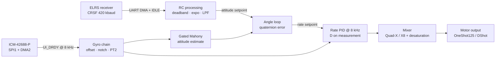

# Logolith


**Logolith** is the flight controller firmware of **Aerolith**, a custom cinelifter built to carry a full-frame mirrorless camera (Sony A7S III class) for cinematic yet dynamic aerial footage.
Portfolio : https://lemonochrme.github.io

Like the rest of Aerolith — frame, ESCs and flight controller — Same philosophy, Logolith is written from scratch rather than forked from Betaflight, ArduPilot or PX4. Every driver, filter and control loop is meant to be understood, measured and justified, not copied.

> ⚠️ **Early stage — work in progress.** Logolith does not fly yet. Sensor and RC drivers are done; the control loops are being built now. See [Status](#status).

---

## Table of contents

- [Goals](#goals)
- [Hardware](#hardware)
- [Firmware architecture](#firmware-architecture)
- [Design rules](#design-rules)
- [Status](#status)
- [IMU validation results](#imu-validation-results)
- [Roadmap](#roadmap)
- [Building and flashing](#building-and-flashing)
- [License](#license)

---

## Goals

- **Stable, predictable flight over state-of-the-art agility.** A cinelifter carrying a camera needs a smooth, well-damped attitude response and robust failure handling, not freestyle-level stick feel.
- **Understand every layer.** Bare-metal C on STM32 **LL** drivers. No HAL, no RTOS, no third-party flight stack. CubeMX is used only to generate peripheral init code.
- **Built for LithCore, portable by design.** The primary target is LithCore, the custom STM32F405 flight controller of Aerolith, but board-specific code is kept as much as possible separate from drivers and control logic so Logolith can be brought up on other F4-class boards and maybe on a future F7 based redesign of LithCore.
- **Measure before tuning.** Each sensor is validated on the bench (noise, bias, self-test) before it is trusted by a control loop.

---

## Hardware

### Aerolith airframe

| Item | Choice |
| --- | --- |
| Frame | Custom carbon cinelifter, 380 mm diagonal, designed in Fusion 360 |
| Configuration | Quad-X first, coaxial X8 later |
| Motors | 3115, 640 KV |
| Propellers | carbon 9050 tri-blade |
| Battery | 4S LiPo (bench / development), 6S (final) |
| ESC | Generic 4in1 50A 30.5x30.5mm ESC (bench / development), individual Custom 60A Aerolith ESC (final) |
| Onboard cam system | RunCam Phoenix 2 SP V3 with AT7456ELAH OSD and RUSHFPV RUSH Tank III Ultimate 30.5x30.5mm, DJI O4 Air Unit mounting holes provided on the chassis (planned for future F7 based custom FC with additional UARTs) |
| Payload | Mirrorless camera, A7S III class |

### LithCore flight controller

| Function | Part | Interface | Firmware status |
| --- | --- | --- | --- |
| MCU | STM32F405RGT6, 168 MHz (8 MHz HSE + PLL), Cortex-M4F | — | ✅ |
| IMU | ICM-42688-P (two possible configs : mounted onboard or on a damped standalone external board, the long term goal is to do archive a precise thermal regulation of the IMU on the stand alone board to archive minimal drift and maximal precision) | SPI1 @ 21 MHz, DMA2, INT2 → EXTI | ✅ |
| Barometer | LPS22HH | I2C | in progress |
| Optical flow | PMW3901 | SPI2, MOTION → EXTI1 | (planned for future F7 based custom FC) |
| Rangefinder | VL53L1X (height above ground for optical flow) | I2C | (planned for future F7 based custom FC) |
| Blackbox | W25Q128 SPI flash (16 MB) | SPI2 | in progress |
| OSD | AT7456ELAH | SPI3 | in progress |
| RC link | ExpressLRS 2.4 GHz, CRSF @ 420 kbaud | UART, DMA circular + IDLE | ✅ |
| GPS | UART module | UART | in progress |
| Motor outputs | OneShot125 | TIM1, TIM3, TIM8 | X4 version ✅, X8 version in progress, (RPM filtering planned for future F7 based custom FC with additional UARTs) |

Power: 5 V rail from an LMR51430 buck, split 3V3 digital / analog rails, and a dedicated low-noise LDO (TPS7A2033) for the IMU.

The RC transmitter is also custom (STM32F411 + ExpressLRS module) and lives in its own repository.

---

## Firmware architecture

### Control structure



A classic cascade:

- **Inner loop — rate PID at 8 kHz.** Triggered by the IMU data-ready interrupt, so the loop is hardware-timed by the sensor rather than by a free-running timer. D term computed on the measurement only (no derivative kick), with its own low-pass filter. Conditional-clamping anti-windup.
- **Outer loop — angle.** The attitude error is computed in SO(3), not by subtracting Euler angles: `q_err = q_current⁻¹ ⊗ q_setpoint`, giving the error in the body frame. The small-angle vector part (`2·q_err.xyz`) feeds a P(I) controller that outputs rate setpoints.
- **Mixer.** Quad-X matrix, then desaturation by renormalization so a saturated motor does not create an unwanted torque. X8 coaxial mixing is planned.

### Attitude estimation

Logolith uses a **single-IMU** estimator: an adaptive Mahony filter running on the ICM-42688-P.

- **Gated accelerometer correction.** Accelerometer feedback is weighted down when `‖a‖` departs from the reference norm measured at boot (≈ 1.025 g uncalibrated on the current board), so manoeuvres and vibration do not pull the horizon.
- **Integral bias tracking.** The Mahony `Ki` term tracks the residual gyro bias in flight, on top of the boot calibration.

A BNO085 fusion chip was evaluated and dropped: running two different MEMS devices in an inner/outer cascade introduces coherence errors (different biases, scale factors and mounting) that cannot be tuned away, plus extra latency, for a marginal accuracy gain over a well-gated single-IMU filter.

### Gyro filtering

```
raw gyro → boot offset (in-sensor) → biquad notch(es) → PT2 low-pass → rate PID (P, I)
                                                       └→ PT1 D-term low-pass → rate PID (D)
```

- The ICM-42688-P anti-alias filter is a configurable low-pass, and its factory notch is fixed, so **motor harmonic rejection is done in software** with biquad notches.
- Notch frequencies are being recomputed for the actual propulsion (640 KV, tri-blade, 4S then 6S).
- Longer term: RPM-tracked dynamic notches from bidirectional DShot telemetry is planned.

### Execution model

Bare-metal, interrupt-driven, no RTOS. The CPU budget on a 168 MHz Cortex-M4F is a few percent, so prioritized interrupts are enough.

- **Sensor → DMA → callback.** A data-ready EXTI starts a DMA burst; the DMA transfer-complete interrupt parses the data and runs the loop. Nothing in the fast path polls.
- **NVIC priorities** follow time-criticality: IMU EXTI and its DMA first (both at the same preemption level, so a new data-ready can never restart a read whose completion handler is still running), then RC link, then slow sensors, telemetry and debug. SysTick (1 ms timebase) sits at the lowest priority.
- **Shared data between loops** (e.g. the 3-float rate setpoint written by the outer loop and read by the inner loop) is exchanged through a double buffer or a short critical section, since a multi-word copy is not atomic on Cortex-M4.

---

## Design rules

These rules come from bring-up issues that actually happened on this project.

1. **Every configuration write is read back and logged at init.** Silent failures are real: a wrong full-scale setting once left the gyro at ±250 dps while the code assumed ±2000 dps (8× error), and a wrong register address once disabled the anti-alias filter.
2. **Interrupts are armed last.** EXTI and DMA interrupts stay disabled (NVIC off, pending flags cleared) until sensor init is complete, so a sensor asserting INT early cannot trigger a half-configured handler.
3. **DMA buffers live in SRAM, never CCM.** CCM RAM is not reachable by the DMA controllers on the STM32F4.
4. **Do not trust eye-closed generated LL init.** CubeMX does not enable the DMA TC interrupt or the SPI peripheral itself; these are done explicitly in the drivers.
5. **The fast-loop sensor owns its bus.** The IMU is alone on SPI1; slower sensors go elsewhere (the barometer was moved to I2C for this reason).
6. **Verify the silicon.** A counterfeit ICM-42688-P (wrong WHO_AM_I, flat single-bank register map) was found and replaced. Critical ICs are sourced from authorized distributors.
7. **`LL_Init1msTick()` does not enable the SysTick interrupt.** It only starts the counter for `LL_mDelay()` polling. Without an explicit `LL_SYSTICK_EnableIT()`, the millisecond counter stayed at 0 and every time-based feature (slow loop, RC failsafe, calibration timeouts) silently never ran.
8. **Never output a dangerous command at boot.** ESC range calibration (full throttle) is a separate, explicit bench procedure; init only outputs the stop pulse, and every motor command defaults to 0.
9. **No blocking debug output in interrupts unless decimated.** Console prints are blocking (~11 µs per character); IMU prints are decimated to ~10 Hz and RC prints run from the main loop, and both are paused during calibrations.

---

## Status

Legend: ✅ done and verified on hardware · 🔧 in progress · 📋 planned

| Module | Status | Notes |
| --- | --- | --- |
| System clock, debug/flash by STLink V3, USB DFU Flashing| ✅ | 168 MHz from 8 MHz HSE |
| ICM-42688-P driver | ✅ | Multi-bank register map (banks 0/1/2/4), low-noise mode, gyro ±2000 dps and accel ±16 g both @ 8 kHz ODR, AAF configured, UI_DRDY on INT2 @ 8 kHz, 13-byte DMA burst. A lost DMA transfer is detected and restarted |
| ICM-42688-P self-test | ✅ | MEMS self-test passes on gyro and accel |
| Boot gyro calibration | ✅ | Bias measured at rest and written to the sensor's `OFFSET_USER` registers (~0.6 s, board still) |
| Accel calibration | 🔧 | An accelerometer calibration (6 poses calibration) is needed on every new mounted chassis to suppress mounting related physical offsets and in sensors naturals offsets. Implemented, bench test pending: started from the radio (SA+SD held 2 s, throttle low), faces detected automatically in any order, bias + full 3×3 scale/cross-axis matrix, sanity checks, applied at 8 kHz in the DMA callback |
| Persistent config storage | 🔧 | Implemented, bench test pending: flash sector 11 reserved (the link fails if the firmware grows into it), append-only log with CRC32, survives reflashing (except a full-chip erase) |
| 1 ms timebase (SysTick) | 🔧 | SysTick interrupt now enabled (see design rule 7), to be confirmed on hardware |
| ELRS / CRSF receiver driver | ✅ | DMA circular buffer + IDLE interrupt, 3-state parser, CRC8 (DVB-S2), RC channels / link statistics / device frames, arming gated on link quality |
| Gyro bias tracking at rest | 🔧 | Catches the post-power-up bias drift (~0.2–0.3 dps) left after the boot calibration |
| Gated Mahony | 🔧 | |
| Software notch + PT2 / PT1 filters | 🔧 | Notch placement for 640 KV / tri-blade |
| Rate PID + Quad-X mixer | 📋 | Target: stable ACRO flight before ANGLE |
| Motor output (OneShot125, then DShot) | OneShot125 ✅, DShot 🔧 | Init outputs the stop pulse only; ESC range calibration is a separate explicit procedure. Board pads M1..M8 mapped to TIM8 / TIM1 / TIM3 in the CubeMX config |
| Arming, failsafe | 🔧 | Link-timeout detection cuts throttle and disarms; failsafe routine, arming lockouts and arm-switch cycling still to do |
| Angle loop (quaternion error) | 📋 | |
| Barometer + altitude hold | 📋 | Complementary filter baro / vertical acceleration |
| Optical flow position hold | 📋 | PMW3901 + VL53L1X |
| Blackbox (SPI flash) | 📋 | Gyro, PID terms, motor commands |
| OSD | 📋 | |
| GPS | 📋 | |
| Coaxial X8 support | 📋 | |

---

## IMU validation results

Measured on LithCore, board at rest on a desk, genuine TDK ICM-42688-P (WHO_AM_I = `0x47`).

| Quantity | Result | Comment |
| --- | --- | --- |
| Gyro noise | ≈ 0.08–0.10 °/s RMS | ~0.4 °/s RMS before the LDO fix |
| Accel noise | ≈ 0.5 mg RMS | |
| Raw gyro bias | ≈ −11 / −1.9 / −8.3 °/s (X/Y/Z) | Above the typical datasheet figure, which is not production-tested. Identical in dps at ±250 and ±2000 dps full scale → genuine analog zero-rate offset, not a configuration artifact |
| Short-term bias stability | ±0.01 °/s | Session-to-session delta ≈ 0.3 °/s |
| Residual after boot calibration | ≈ 0.2 °/s | Post-power-up drift, handled by bias tracking |
| Accel norm at rest | ≈ 1.021–1.026 g | Z zero-g offset at the datasheet limit; corrected by a 6-position calibration on the frame, applied in software |
| Self-test | PASS (gyro and accel) | |

Accelerometer offsets are deliberately **not** calibrated at boot: doing so would absorb the real tilt of the drone on the ground.

---

## Roadmap

### Immediate next steps

1. **Bench-test the accelerometer calibration:** run the 6 faces, check that the result is saved and reloaded after a reboot (the IMU debug print should read ~0 / 0 / ±9.81 m/s² when flat).
2. **Choose a latching arm switch** (SF) and move `armed` off CH5: SA is a momentary push button on the radio.
3. **Security module:** arming lockouts, arm-switch cycling after failsafe or calibration, real failsafe routine.
4. **Motor mapping test** with `ESC_Test()` (props off): motor position and spin direction for each pad.
5. Then Phase 2 below.

### Known TODOs

- **Re-arm after failsafe:** when the RC link comes back, `armed` follows the switch immediately, so the drone re-arms if the arm switch was left on. Arming must require the switch to be cycled first.
- **Arming lockouts:** refuse arming while an accelerometer calibration is running (`AccelCal_InProgress()`), when no valid accelerometer calibration is loaded (`AccelCal_IsValid()`), and right after a calibration until the arm switch has been cycled.
- **Motor mapping:** pad ↔ timer channel is confirmed (M1..M4 = PC6..PC9 = TIM8 CH1..CH4, M5..M7 = PA8..PA10 = TIM1, M8 = PB1 = TIM3); the motor position on each pad and the spin directions are still to check (see `esc_driver.c`).
- **ESC update rate:** OneShot125 runs at 1 kHz; raise it (up to ~3.9 kHz) or move to DShot once the 8 kHz rate loop is in place.
- **ESC_M8 timer scale:** TIM3 is clocked from APB1, so its timer runs at 12 MHz instead of 24 MHz and its pulse values are half those of M1..M7.

### Phases

**Phase 1 — Sensing and link** *(mostly done)*
ICM-42688-P driver, boot calibration, CRSF receiver, accelerometer 6-face calibration with flash storage (bench test pending). Remaining: bias tracking at rest.

**Phase 2 — ACRO flight**
Software notch + PT2 + D-term filtering, rate PID, Quad-X mixer with desaturation, motor output, arming and failsafe. The drone must be stable in ACRO before anything else.

**Phase 3 — ANGLE flight**
Gated Mahony, quaternion error in body frame, angle loop. Hover tests.

**Phase 4 — Altitude and position**
LPS22HH over I2C (with the STM32F4 I2C errata handled: non-blocking transfers, timeouts, bus recovery), altitude hold, then optical-flow position hold with PMW3901 + VL53L1X, then GPS.

**Phase 5 — Tooling**
Blackbox logging to SPI flash, OSD, CLI for in-field gain tuning.

**Phase 6 — Aerolith final configuration**
6S validation, coaxial X8 mixing, bidirectional DShot telemetry for RPM-tracked notches and closed-loop motor speed with the Aerolith ESCs.

---

## Building and flashing

### Requirements

- Visual Studio Code with the **STM32Cube for VS Code** extension (CMake + Arm GNU toolchain)
- An ST-Link (SWD), or a USB-C cable for DFU

### Build

Open the folder in VS Code and build with the extension, or from a terminal:

```sh
cmake --preset Debug
cmake --build --preset Debug
```

### Flash

- **SWD:** ST-Link on the SWD header, flash and debug from VS Code.
- **USB DFU:** hold BOOT0 while plugging in USB-C, then flash with STM32CubeProgrammer App or use the script "flash_DFU.sh" made by me (with love) directly in your terminal (you will need STM32CubeProgrammer CLI installed), with this command:

```sh
./flash_DFU.sh
```

Debug outputs are enabled / disabled per subsystem with the `debug_*` flags in `global.c` (register readback, IMU data ~10 Hz, RC link quality and channels at 5 Hz, warnings) and are printed on the debug UART (UART5, 921600 baud).

---

## License

[MIT](LICENSE)
